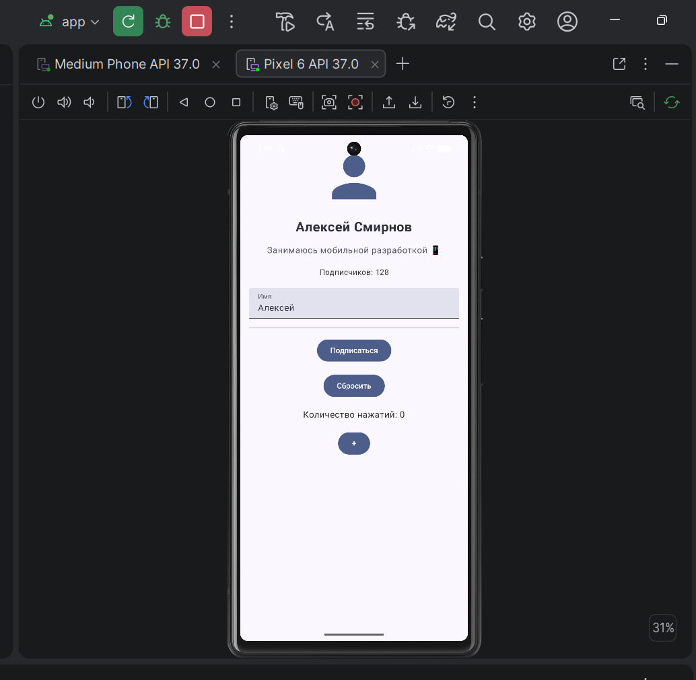

# Отчёт по лабораторной работе №3

## Информация о студенте
- **ФИО:** Лаврентьев Аврам Петрович
- **Группа:** ПИН-б-о-24-1
- **Дата выполнения:** 03.11.2026

## Цель работы
Освоить базовые компоненты Jetpack Compose, научиться использовать Modifier для стилизации и позиционирования элементов, управлять состоянием с помощью remember и mutableStateOf, создать адаптивный экран профиля пользователя с интерактивными элементами и подготовить проект к дальнейшей интеграции с архитектурой MVVM.

## Что было сделано
1. Создал проект ProfileApp в Android Studio с использованием Jetpack Compose.
2. Создал модель данных пользователя User.kt.
3. Реализовал компонент Avatar.kt для отображения аватара пользователя.
4. Реализовал компонент ProfileInfo.kt для отображения имени, статуса и количества подписчиков.
5. Реализовал компонент ActionButtons.kt для кнопок взаимодействия с пользователем.
6. Создал основной экран ProfileScreen.kt, объединив компоненты профиля.
7. Реализовал изменение состояния подписки с помощью remember и mutableStateOf.
8. Добавил TextField для редактирования имени пользователя.
9. Реализовал кнопку сброса имени пользователя.
10. Добавил счётчик нажатий и кнопку его увеличения.
11. Использовал Modifier для настройки расположения и внешнего вида элементов интерфейса.
12. Добавил аннотации @Preview для предварительного просмотра компонентов.
13. Запустил приложение в эмуляторе Android и проверил работу интерактивных элементов.

## Выводы
В ходе лабораторной работы были освоены базовые компоненты Jetpack Compose и принципы создания пользовательского интерфейса на Kotlin. Получены навыки использования Modifier, управления состоянием через remember и mutableStateOf, создания переиспользуемых Composable-компонентов и реализации интерактивности. Разработано приложение ProfileApp с экраном профиля пользователя, которое успешно запущено и протестировано в эмуляторе Android.

## Контрольные вопросы для защиты

### 1. Что такое Jetpack Compose и в чём его отличие от XML-вёрстки?

Jetpack Compose — это современный инструментарий для создания пользовательского интерфейса Android-приложений с использованием языка программирования Kotlin.

Основное отличие Jetpack Compose от XML-вёрстки заключается в способе создания интерфейса:

- При XML-вёрстке внешний вид элементов описывается в XML-файлах, а логика взаимодействия реализуется отдельно в Kotlin или Java.
- В Jetpack Compose интерфейс создаётся непосредственно с помощью Kotlin-кода и специальных функций с аннотацией `@Composable`.
- Compose позволяет объединять описание интерфейса и его поведение в одном месте.
- В Compose используется декларативный подход: разработчик описывает, каким должен быть интерфейс при определённом состоянии приложения.

Таким образом, Jetpack Compose упрощает разработку интерфейсов, уменьшает количество шаблонного кода и позволяет удобнее управлять состоянием UI.

### 2. Что такое @Composable-функция?

`@Composable` — это специальная аннотация Kotlin, которая указывает, что функция предназначена для построения пользовательского интерфейса с помощью Jetpack Compose.

Такие функции могут содержать другие Composable-функции, например `Text()`, `Button()`, `Column()` и `Row()`.

Пример:

```kotlin
@Composable
fun Greeting() {
    Text(text = "Привет, пользователь!")
}
```

В данном примере функция `Greeting()` отображает текст на экране.

Composable-функции позволяют разбивать интерфейс на отдельные компоненты, которые можно повторно использовать в разных частях приложения.

### 3. Что такое Modifier и приведите примеры его использования.

`Modifier` — это специальный объект Jetpack Compose, который позволяет изменять внешний вид, расположение, размер и поведение элементов интерфейса.

С помощью Modifier можно:
- задавать отступы;
- устанавливать размеры элементов;
- изменять фон;
- добавлять рамки;
- выравнивать элементы;
- обрабатывать нажатия;
- изменять форму элементов.

Примеры:

```kotlin
Text(
    text = "Профиль пользователя",
    modifier = Modifier.padding(16.dp)
)
```

В этом примере задаются внешние отступы в 16 dp.

```kotlin
Icon(
    imageVector = Icons.Default.Person,
    contentDescription = "Аватар",
    modifier = Modifier.size(120.dp)
)
```

Здесь задаётся размер иконки 120 dp.

В лабораторной работе Modifier использовался для настройки размеров аватара, расположения элементов, отступов и оформления компонентов профиля.

### 4. Как управлять состоянием в Compose? Что такое remember?

Состояние — это данные, от изменения которых зависит отображение пользовательского интерфейса.

В Jetpack Compose для управления состоянием используются `mutableStateOf()` и `remember`.

`mutableStateOf()` создаёт наблюдаемое состояние. Когда его значение изменяется, Compose узнаёт об этом и обновляет интерфейс.

`remember` позволяет сохранять значение состояния между рекомпозициями Composable-функции.

Пример:

```kotlin
var counter by remember {
    mutableStateOf(0)
}
```

В данном примере создаётся переменная `counter`, которая хранит число и сохраняет его при рекомпозиции.

При изменении значения:

```kotlin
counter++
```

интерфейс обновляется автоматически.

В лабораторной работе состояние использовалось для:
- изменения подписки пользователя;
- редактирования имени;
- увеличения счётчика нажатий.

### 5. Как работает рекомпозиция в Compose?

Рекомпозиция — это повторное выполнение Composable-функций для обновления пользовательского интерфейса при изменении состояния.

Когда значение состояния, от которого зависит интерфейс, изменяется, Compose определяет, какие части интерфейса необходимо обновить.

Например, при нажатии на кнопку увеличения счётчика:

```kotlin
counter++
```

изменяется состояние счётчика. Compose выполняет рекомпозицию соответствующих элементов и отображает новое значение.

Рекомпозиция позволяет обновлять интерфейс без необходимости вручную изменять каждый элемент.

### 6. В чём разница между Column и Row?

`Column` и `Row` — это компоненты Jetpack Compose, предназначенные для размещения элементов интерфейса.

**Column** располагает элементы вертикально, один под другим.

Пример:

```kotlin
Column {
    Text("Имя пользователя")
    Text("Статус")
    Button(onClick = {}) {
        Text("Подписаться")
    }
}
```

В данном примере элементы размещаются сверху вниз.

**Row** располагает элементы горизонтально, один рядом с другим.

Пример:

```kotlin
Row {
    Text("Имя")
    Text("Фамилия")
}
```

В данном примере элементы располагаются слева направо.

Таким образом, `Column` используется для вертикального расположения компонентов, а `Row` — для горизонтального.

### 7. Как использовать TextField в Compose?

`TextField` — это компонент Jetpack Compose, предназначенный для ввода и редактирования текстовой информации пользователем.

Для его работы необходимо:
- задать значение текста через параметр `value`;
- указать обработчик изменения текста через `onValueChange`;
- хранить введённое значение в состоянии;
- при необходимости указать подпись поля через `label`.

Пример:

```kotlin
var name by remember {
    mutableStateOf("")
}

TextField(
    value = name,
    onValueChange = {
        name = it
    },
    label = {
        Text("Имя")
    }
)
```

В данном примере пользователь может вводить текст, а переменная `name` будет обновляться при каждом изменении.

В лабораторной работе TextField использовался для редактирования имени пользователя в профиле.

### 8. Что такое Divider и для чего он нужен?

`Divider` — это компонент Jetpack Compose, предназначенный для визуального разделения элементов интерфейса.

Он представляет собой горизонтальную или вертикальную разделительную линию, которая помогает структурировать содержимое экрана.

Пример:

```kotlin
Divider()
```

Divider позволяет визуально отделить одну группу элементов от другой.

В лабораторной работе Divider использовался для разделения информации о пользователе и блока кнопок.

### 9. Для чего нужна аннотация @Preview?

`@Preview` — это аннотация Jetpack Compose, которая позволяет отображать предварительный просмотр Composable-функций непосредственно в Android Studio.

Она позволяет:
- просматривать интерфейс без запуска приложения в эмуляторе;
- проверять расположение компонентов;
- оценивать внешний вид элементов;
- быстрее разрабатывать и изменять интерфейс.

Пример:

```kotlin
@Preview(showBackground = true)
@Composable
fun ProfileScreenPreview() {
    ProfileScreen()
}
```

В данном примере Android Studio отображает предварительный просмотр экрана профиля.

В лабораторной работе аннотация `@Preview` использовалась для предварительного просмотра отдельных компонентов и основного экрана приложения.

### 10. Как вынести повторяющийся код в отдельный компонент?

Для повторного использования элементов интерфейса в Jetpack Compose создаются отдельные Composable-функции.

Это позволяет разделить интерфейс на небольшие компоненты, каждый из которых выполняет определённую задачу.

Например, вместо размещения всего кода профиля в одной функции можно создать:
- `Avatar()` — отображение аватара;
- `ProfileInfo()` — отображение информации о пользователе;
- `ActionButtons()` — отображение кнопок взаимодействия;
- `ProfileScreen()` — объединение всех компонентов в один экран.

Пример:

```kotlin
@Composable
fun Avatar() {
    Icon(
        imageVector = Icons.Default.Person,
        contentDescription = "Аватар"
    )
}
```

После создания компонента его можно использовать в других Composable-функциях:

```kotlin
@Composable
fun ProfileScreen() {
    Column {
        Avatar()
        Text("Профиль пользователя")
    }
}
```

Разделение интерфейса на компоненты делает код более понятным, удобным для сопровождения и повторного использования.


